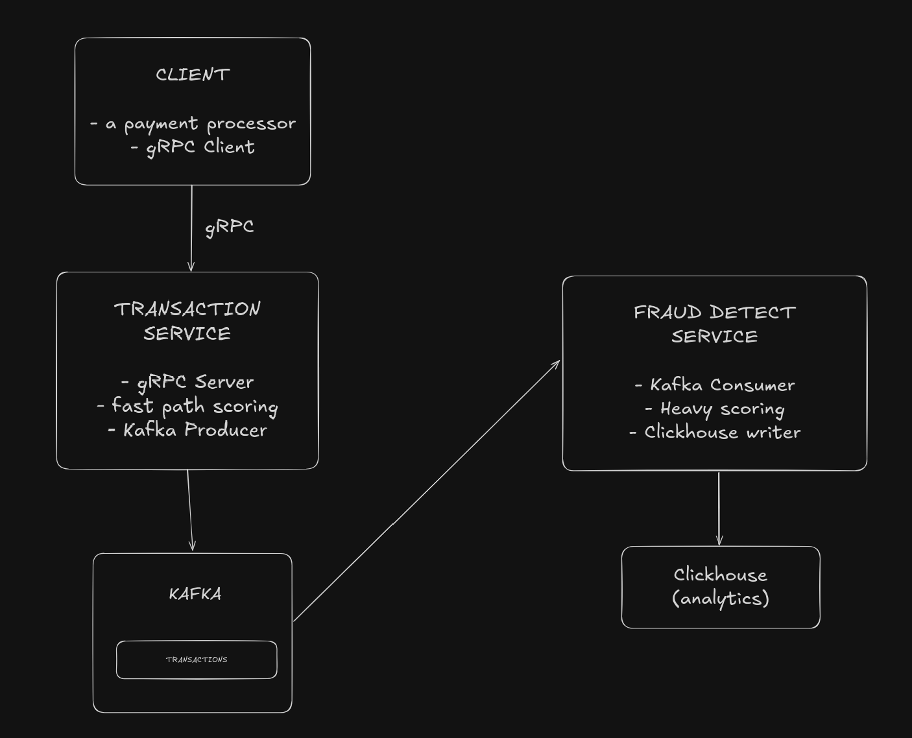
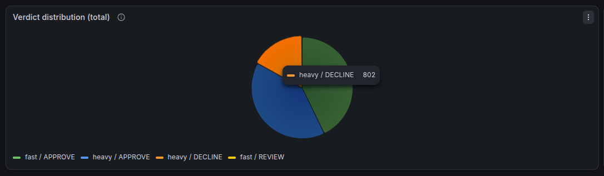
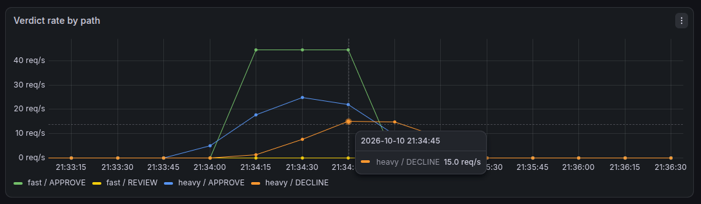
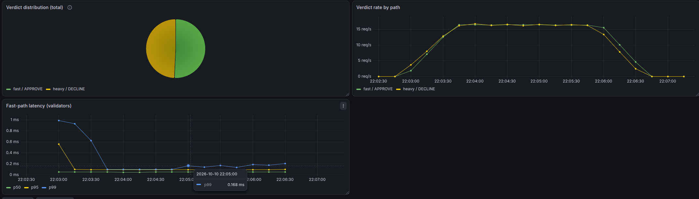
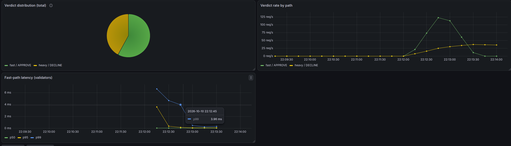
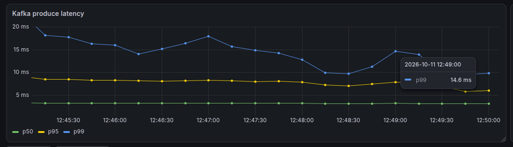
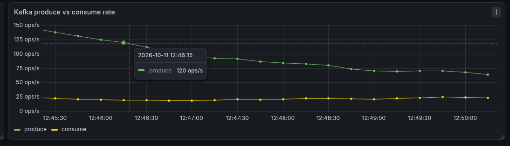
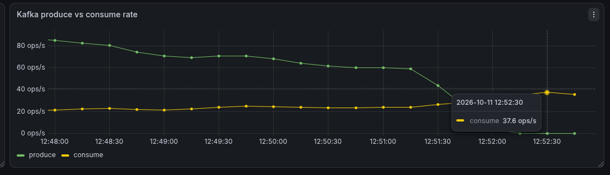
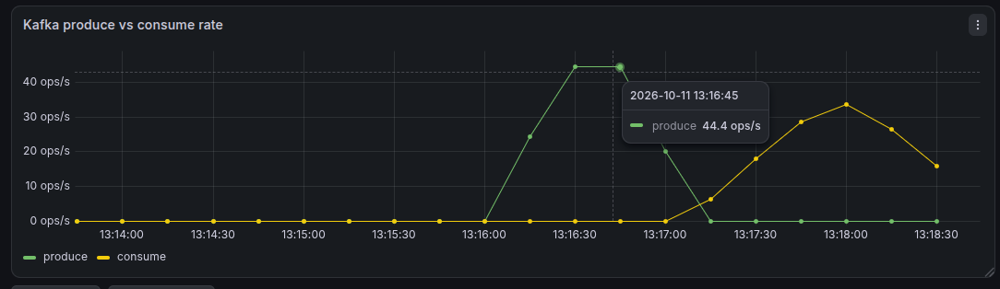
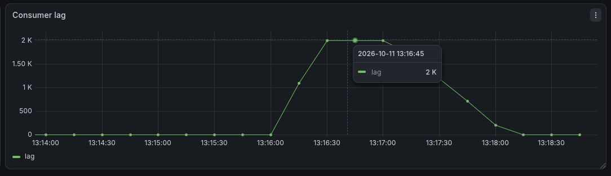

# Fraud detection engine 

# Architecture

 

# Measurements 

## Verdict distribution

First measurement is how many `APPROVE`, `REVIEW` and `DECLINE` verdicts each path produces. We can see in the image below the distribution and that 787 transactions were flagged for fraud during the simulation test.

 

Second measurement is the verdict rate by path, where the fraud requests reached a high of 15 per second. 

 

## Fast-path latency

Measure whether the fast path stays indeed fast.

A light load, about 16 req/s for about 3 minutes (~3000 samples, 5 concurrent):

- 98.8% of 3,001 samples were ≤ 0.1 ms
- 99.5% were ≤ 0.25 ms 
- 99.9% were ≤ 1 ms (with 4 samples being above 1 ms)

A heavy load, about 160 req/s for about 40 seconds (~6000 samples, 50 concurrent): 

- 97.2% were ≤ 0.5 ms
- 97.6% were ≤ 1 ms (143 samples, or 2.4%, were above 1 ms)
- 99.6% were ≤ 5 ms (25 samples, or 0.4%, were above 5 ms)
- 99.9% were ≤ 10 ms

## Kafka produce latency and throughput

Here I wanted to see kafka's produce latency and also the produce vs consume rate. 

Produce latency is low and stable and latency didn't raise as the run went on, even as the produce rate changed. 
p50 was under 5 ms, p95 about 6-8.5 ms and p99 about 10-18 ms based on the graph below. 

 

Consume throughput was far lower and flat, it sat at about 20-25 messages per second for the whole run, however much was being produced (around 65 messages per second).
So the producer outpaced the consumer, so lag accumulated for the whole run. 

 

Then, I stopped the simulation run and noticed that the consumer sped up when the load stopped. It rose to about 35-37 messager per second and kept going. 

So, we can say that the write path from risk_engine to Kafka is cheap and doesn't degrade under about 100-140 messages per second. Seems that the pipeline's limit is downstream in stream_processor. Under load it consumed about 22 msg/s against 140/s produced. 

Heavy-path throughput is roughly 22 msg/s under concurrent load and roughly 35-37 msg/s when draining. 

## Consumer lag build and drain

For this test, I stopped the consumer from running and sent about 2000 transactions (50 concurrent). 
After restarting it, we should see the lag fall back to 0. 

 

We can observe that lag went from 0 to 2000 which matches the number of our sent transactions, so no messages were lost on the way to Kafka.  

And lag stayed flat at 2k for about 30s while stream_processor was stopped. 

After I restarted stream_processor, lag falls from 2k to 0 over the span of about a minute. And the consume rate peaks at about 34 msg/s after the restart.  

This proves that the heavy path doesn't need to keep pace with the fast path. A 2000 message burst built up and drained completely in about a minute, with no loss and no stuck lag. 

So, a sustained load would build lag. The backlog would grow by about 125 messages per second (or 7500 per minute).
The burst tests so far can't tell where the limit sits, only how big it is. We might be able to see the limit in the following tests. 

